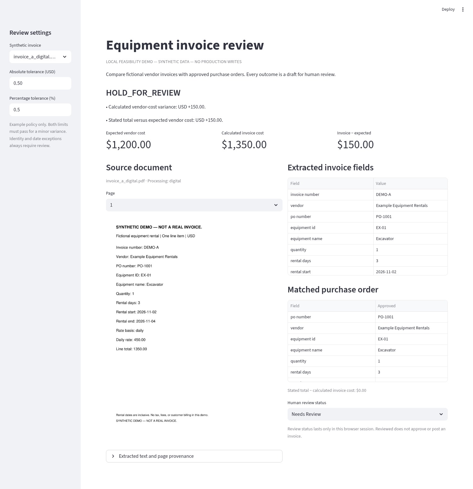

# Equipment invoice reconciliation demo

Equipment-rental invoices need to be checked against approved purchase orders before staff decide how to handle them. This proof of concept reads fictional digital and scanned PDFs, validates a small set of fields, and applies explicit vendor-cost comparison rules. A human reviews every draft result; the application never posts invoices or updates a business system.

This is an independent feasibility exercise, not commissioned work, a production system, or a claim of affiliation with Nimble Equipment Management. Every invoice is labelled **SYNTHETIC DEMO — NOT A REAL INVOICE.** No real business documents, credentials, external AI APIs, or local models are used.

## Pipeline

```text
PDF page → usable embedded text? ─yes→ PyMuPDF text
                       └─────────no──→ rendered pixels → local Tesseract
    → labelled-field parser → Pydantic validation → PO CSV comparison
    → Decimal calculations + explicit thresholds → Streamlit human review
```

Text extraction and field parsing are separate steps. The parser recognizes the generated English label/value format; it is not an LLM or a general invoice/table extractor. Ground truth is used only for evaluation, never to supply extraction answers.



## Cloud or Mac?

The complete baseline was built and tested in a cloud development machine. You can keep developing there; no Mac setup, GPU, database, paid service, or model download is needed. After installation, the application runs without external requests. Cloud execution still means files reside on a cloud host; use only the bundled synthetic documents.

A Mac is useful for a portable demonstration or later testing documents that must stay on that machine. Running your development chat on the Mac is optional and does not change the application architecture. The Python application itself can run locally without any chat tool. Linux execution is verified here; the macOS steps below are documented but were not executed on a Mac.

### Existing cloud environment

From `/workspace/local-PDF-to-reconciliation-workflow`:

```bash
source .venv/bin/activate
python -m pytest -q
python -m streamlit run app.py --server.address=0.0.0.0
```

Use the cloud product's app/port access controls for port 8501 if available. A cloud machine's loopback address refers to that machine, not your laptop. If the product has no way to open the app, use the local Mac instructions for the interactive demo; the cloud tests and saved screenshot still work.

### Exact macOS setup

Required: Git, Python **3.12**, the Tesseract executable with English language data, and a browser. Jupyter and all Python libraries come from the lockfile. A code editor is optional; Docker Desktop is optional. If Homebrew is missing, install it using the instructions at https://brew.sh before these commands.

```bash
brew install python@3.12 tesseract git
git clone https://github.com/bkrishnanair/local-PDF-to-reconciliation-workflow.git
cd local-PDF-to-reconciliation-workflow
python3.12 -m venv .venv
source .venv/bin/activate
python -m pip install --require-hashes -r requirements.txt
tesseract --version
tesseract --list-langs  # must include eng
python -m scripts.generate_demo
python -m pytest -q
python -m scripts.evaluate
python -m scripts.execute_notebook
python -m streamlit run app.py
```

Open the address printed by Streamlit in your Mac browser. To explore the executed notebook, stop Streamlit with Ctrl-C, then run:

```bash
python -m jupyterlab notebooks/ocr_evaluation.ipynb
```

Use the **Reconciliation demo** kernel installed by `scripts.execute_notebook`. Outputs in the committed notebook were actually executed, not written in as expected answers. Running the evaluation replaces its measured report in `docs/evaluation.json`.

**Source availability:** the cloud checkout currently contains the new implementation. Cloning on a Mac requires publishing these files to the repository first; an empty remote cannot supply them. Once reviewed, the checkout's current branch can be published as `main` with `git push -u origin HEAD:main`. No push is performed by the application.

### Fresh Linux setup

Install Python 3.12, `python3-venv` if your distribution separates it, and `tesseract-ocr` / `tesseract-ocr-eng`. Then use the same virtualenv and Python commands above, replacing `python3.12` with your Python 3.12 executable. Poppler is unnecessary: PyMuPDF renders the pages for OCR and previews.

### Optional Docker

```bash
docker build -t equipment-reconciliation-demo .
docker run --rm --network none equipment-reconciliation-demo python -m pytest -q
docker run --rm -p 127.0.0.1:8501:8501 equipment-reconciliation-demo
```

The default command runs the review app. On a development network with an HTTPS-inspecting proxy, supply its trusted **public CA bundle** without copying it into the image:

```bash
docker build --secret id=build_ca,src=/etc/ssl/certs/ca-certificates.crt -t equipment-reconciliation-demo .
```

That bundle path is the tested cloud host path, not a macOS prerequisite. Ordinary networks can use the first build command. TLS and package hash verification stay enabled. See [validation evidence](docs/validation.md) for what was actually tested.

## What the rules do

PO lines are selected by PO number and equipment ID; dates disambiguate repeated equipment lines. Duplicate or unresolved lines require review. Vendor, equipment name, quantity, inclusive rental dates, rental days, and rate basis are checked after selection. Unsupported rate bases, identity mismatches, and inconsistent dates always force review even if the amount difference is zero.

All money is USD `Decimal`, never floating point:

```text
expected vendor cost = approved daily rate × invoice quantity × invoice rental days
calculated invoice cost = invoice daily rate × invoice quantity × invoice rental days
difference = calculated invoice cost − expected vendor cost
```

If quantity or days differ from the PO, those calculations are diagnostic only: the structural exception still forces a hold. A stated total, if supplied, is compared with both the calculated invoice cost and expected vendor cost. If absent, that limitation is displayed. There are no taxes, fees, customer billing rates, partial days, or rounding/allocation rules in this format.

Default tolerances are **$0.50 AND 0.5%** of the relevant baseline, inclusive. Both must pass for every nonzero monetary difference to be minor. Negative variances use their absolute magnitude. A zero baseline allows only an exact match. These are demonstration settings, not approved business policy.

| Outcome | Meaning |
| --- | --- |
| `MATCHED_DRAFT` | Required fields and compared amounts match; still a draft |
| `MINOR_VARIANCE_REVIEW` | Nonzero monetary differences satisfy both limits |
| `HOLD_FOR_REVIEW` | Structural exception, ambiguous PO line, or excessive monetary difference |
| `MISSING_INFORMATION` | A required field is absent, including a missing PO |
| `UNMATCHED_PO` | A supplied PO number has no approved record |
| `EXTRACTION_REVIEW` | Duplicate/ambiguous labels or malformed field values prevent trusted parsing |

Parsing errors take precedence; required missing fields are checked before matching. No outcome means payment approval. The `Reviewed` control changes only browser-session state; it survives switching invoices in the session, resets when inputs/policy change, and is not a durable audit record.

## Fictional cases and measured results

`python -m scripts.generate_demo` creates the fixtures and independent field ground truth:

| Invoice | Source | Expected behavior, verified in tests |
| --- | --- | --- |
| A | Digital excavator, $450/day vs $400/day, 3 days | $150 overcharge; hold |
| B | Image-only scissor lift, $150/day, 2 days | $0 difference; matched draft, real OCR |
| C | Digital, unrecognized PO | Unmatched PO |
| D | Digital, wrong equipment ID | Hold without selecting a PO line |
| E | Digital, absent PO number | Missing information |
| F | Digital, wrong rental dates | Hold despite $0 monetary difference |

The recorded extraction measurement recovered **60/60 fields on five digital documents** and **12/12 fields on one clean scan**, with no field errors. The missing PO slot is counted correct only when it remains absent. These are field-extraction scores, not character OCR scores. Tesseract 5.5.0 and PyMuPDF 1.26.7 were used. The scanned fixture has a real image and no embedded text layer; its recovered text is in the report and notebook.

Read [the measured JSON report](docs/evaluation.json), [executed notebook](notebooks/ocr_evaluation.ipynb), and [validation record](docs/validation.md). The test suite covers actual OCR, validation, calculations, matching, both thresholds, zero baselines, missing fields, ambiguous dates/labels, corrupt PDFs, and session review controls.

## Read the code in this order

| File | Responsibility |
| --- | --- |
| `scripts/generate_demo.py` | Fictional documents, PO CSV, ground truth |
| `reconciliation/pdf.py` | Per-page extraction, OCR, provenance, warnings |
| `reconciliation/parser.py` | Known-format field parsing; ambiguity is explicit |
| `reconciliation/models.py` | Validated schemas, money, policy, outcomes |
| `reconciliation/reconcile.py` | PO selection and deterministic comparison rules |
| `reconciliation/pipeline.py` | Connect the components |
| `app.py` | Source preview and session-only human review |
| `reconciliation/evaluation.py` | Field comparisons against synthetic ground truth |

`requirements.in` pins direct dependencies; `requirements.txt` locks transitive versions and hashes with platform markers for Python 3.12. Dependency updates are deliberate: use `uv pip compile requirements.in --python-version 3.12 --universal --generate-hashes --output-file requirements.txt`, reinstall, and rerun validation. A cross-platform lock does not substitute for testing on a Mac.

## Limitations and next experiments

This is a single-invoice, single-line, English, USD demonstration. It supports exact labelled fields and ISO dates, not arbitrary invoice layouts, genuine tables, multiple line items, credits, tax, handwriting, rotation, or poor scans. The text-layer heuristic uses at least 40 alphanumeric characters per page; a misleading partial layer can defeat it. OCR is local but not infallible. File limits bound pages and OCR pixels, not every possible hostile-file resource issue; this is not an upload service.

Only generated fixtures were measured, including one clean scan. Do not describe the measured scores as performance on unseen vendor invoices. The optional Ollama experiment is **NOT IMPLEMENTED / NOT TESTED**; no usable Ollama installation was present, and no model is required.

Before real-document experiments, obtain explicit permission and approved storage/processing arrangements, then use a representative de-identified sample. Label held-out ground truth, include bad scans and multiple layouts, record field-level errors and critical mismatches, and test duplicate PO lines and actual rental conventions. Ask business owners to define tolerances, date rules, taxes, credits, and acceptable error rates. Human sign-off, audit history, and any production integration require a separate design.

## Your manual tasks before the follow-up

1. Open the app and walk through A, B, E, and F. Show the source next to the extracted and approved values; mark a record Reviewed and explain that nothing posts.
2. Try a tolerance example: on A, set the absolute limit to `200.00` and percentage to `20`. It becomes a minor variance requiring review; restore `0.50` / `0.5`. Wrong dates must remain a hold.
3. Read the short modules in the order above and explain the $150 calculation without looking at code.
4. Review the screenshot and synthetic files before sharing. Review and publish the cloud environment settings if you want a reusable snapshot. Publish the source to your repository separately so cloning works; a saved environment is not a source-code push.
5. Rehearse [the 60-second demo](docs/demo-script.md), answer [the five practice questions](docs/practice.md), and describe the small test set honestly. Request permission before testing any actual company invoice.

No manual API-key entry, model installation, NVIDIA software, or production credentials are needed for this baseline.
